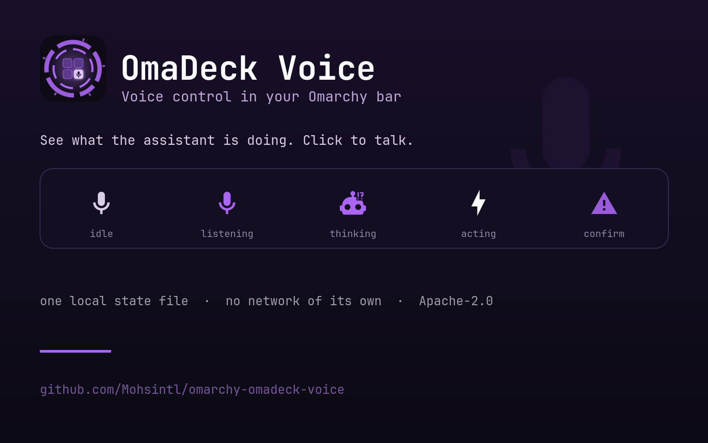

# OmaDeck Voice

A bar widget for [OmaDeck](https://github.com/Mohsintl/omadeck) voice control on
[Omarchy](https://omarchy.org). It shows what the assistant is doing and toggles
the microphone without leaving the bar.



| State | Icon | Meaning |
|---|---|---|
| unconfigured | gear | OmaDeck is not installed, or its service is not running. Click opens the setup guide. |
| stopped | mic off | The daemon is installed but not listening. |
| idle | mic | Ready. Click starts listening. |
| listening | mic, accent | Capturing speech. Click stops. |
| thinking | sparkle | Transcribing or asking the model. |
| acting | bolt | Running a desktop action. |
| confirm | question | Waiting for confirmation. Click confirms. |
| error | mic off | The state file could not be read. |

The tooltip shows the current state and, when there is one, the last transcript.

## Requirements

- **Omarchy** with the plugin-capable shell (Quattro). This widget uses the
  `BarWidget` API, so it does not load on older Omarchy releases.
- **OmaDeck** installed and running on the same machine. The widget reads
  `$XDG_RUNTIME_DIR/omarchy-voice/state.json` and calls the `omarchy-voice`
  command; both come from OmaDeck, not from this repository.

  ```sh
  git clone https://github.com/Mohsintl/omadeck.git
  cd omadeck
  git checkout 3f3e0baaa32d836365c0a7ecee0c6f097eba5216
  ./install.sh --quick
  ```

  `--quick` installs the voice daemon and its systemd user service, then shows
  the pairing steps. Voice and AI keys are optional and can be added later.
- **A Nerd Font** for the icon glyphs. Omarchy ships JetBrainsMono Nerd Font,
  so this is already satisfied on a stock install.

The widget has no network access of its own and no dependencies beyond Omarchy
and OmaDeck.

## Install

```sh
omarchy plugin add https://github.com/Mohsintl/omarchy-omadeck-voice.git --enable
```

The plugin lands in the `right` section of the bar. To place it somewhere else:

```sh
omarchy bar move io.github.mohsintl.omadeck-voice --section centerEnd
omarchy bar move io.github.mohsintl.omadeck-voice --after omarchy.clock
```

Valid sections are `left`, `centerBegin`, `center`, `centerEnd`, `tray` and
`right`. Check the manifest and entry point at any time with:

```sh
omarchy plugin validate ~/.config/omarchy/plugins/io.github.mohsintl.omadeck-voice
```

## Remove

Take the widget off the bar but keep the checkout:

```sh
omarchy plugin disable io.github.mohsintl.omadeck-voice
```

Remove the plugin entirely:

```sh
omarchy plugin remove io.github.mohsintl.omadeck-voice
```

Removing this plugin does not touch OmaDeck or its service. To remove OmaDeck
itself, run `./uninstall.sh` from its checkout (`--purge` also removes keys and
certificates).

## How it works

OmaDeck's daemon writes a small JSON file at
`$XDG_RUNTIME_DIR/omarchy-voice/state.json` on every state transition, and a
`level` file with microphone loudness while listening. This widget reads
`state.json` with a `FileView` watcher and paints one of the icons above.

Clicking runs `omarchy-voice listen toggle`; while a confirmation is pending it
runs `omarchy-voice listen confirm`. Both commands are local. Nothing is sent
anywhere by the widget.

The state file is the only integration point, so the widget cannot get out of
sync with the daemon: when the service stops it writes a final `stopped` state,
and when it has never run the file is missing and the gear appears.

## Troubleshooting

- **The gear never goes away.** OmaDeck is missing or its service is down.
  Check `systemctl --user status omarchy-voice.service` and start it with
  `systemctl --user start omarchy-voice.service`. Clicking the gear opens the
  OmaDeck setup guide.
- **The icon is a blank box.** The bar is not using a Nerd Font. Omarchy's
  default JetBrainsMono Nerd Font has every glyph used here.
- **Clicks do nothing.** Run `omarchy-voice listen toggle` in a terminal and
  check `omarchy-voice-doctor`; the widget only forwards that command.
- **`omarchy plugin add` refuses the repository.** Validate a local checkout
  first: `omarchy plugin validate .` from the repository root.

## License

Apache-2.0. See [LICENSE](LICENSE) and [NOTICE](NOTICE).

The QML is extracted from [OmaDeck](https://github.com/Mohsintl/omadeck), which
is also Apache-2.0. OmaDeck Voice is an independent plugin repository so the
widget can be discovered and installed through the Omarchy plugin marketplace.
